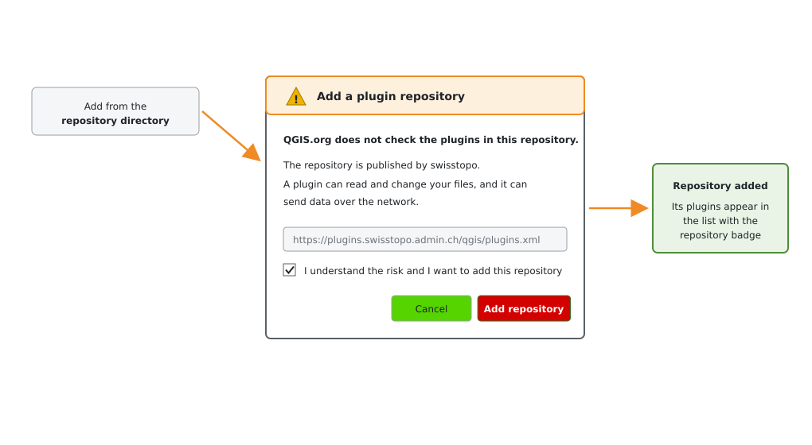

# QGIS Enhancement:  Overhaul the QGIS plugin ecosystem

**Date** 2026/10/14

**Author** Lova Andriarimalala (@Xpirix) and Tim Sutton (@timlinux)

**Contact** lova at kartoza dot com / tim at kartoza dot com

**Version** not applicable

# Summary

The QGIS plugin ecosystem is a major selling point for QGIS and at the same time a cause for concern on security, social and technical grounds.

**During the  the contributor meeting in Laax, October 2026** we had a discussion to gather ideas and suggestions about how could we improve the QGIS Plugins repository. We are facing problems due to its exponential growth. This proposal stems from these discussions and moves us toward the federation of the majority of  plugins away to other repositories.

The problems we want to solve:

- **Overload:** There are too many new plugins/versions arriving on the Plugins repo for us to review effectively. The AI-assisted plugin development boom has increased the volume. We went from about 3k plugins at the beginning of 2026 to about 4.7k in October 2026. Reviews are shallow and there is only one main volunteer contributor (Admire a.k.a @NyakudyaA)  who does the reviews.

- **Security:** A plugin can do almost anything on the user's system and a proper security review for each plugin is not realistic with current resources we have.
- **Quality:** Some points were raised during the discussion about plugins that are forked from existing ones, plugins without open issue trackers, ones that are not easy to find in QGIS, ones with functionality duplicated, ones with non-English description.
- **Tagging:** We don't have a proper tagging system to allow users to filter out desirable or undesirable plugins. We envisage tags like:  AI-assisted, needs subscription, binary blobs, post-install downloads, ads, manual installation....etc.
- **Infrastructure pressure:** some parties harvest the whole repository regularly. This eats bandwidth, causing us to often exceed the Hetzner traffic cap. When we exceed the traffic cap it incurs overage fees. Batch downloaders also make download counts meaningless. 
- **Rating Farming:** Ratings were open to vote-farming and have now been removed.

Earlier this year, we have implemented the QA and security checks ([QEP 409](https://github.com/qgis/QGIS-Enhancement-Proposals/blob/master/qep-409-plugins-security-validator.md)). It detects code-related security and quality issues for each plugin uploaded. However, the concerns related to the points mentioned above still remain, and the majority of the checks are not mandatory so the system is not as effective as we might hope for.

## Terminology

**1. Directory**: A list of plugin repositories with a low bar to entry to be added to the list.
**2. Repository**: A collection of plugins hosted by QGIS.org, a User Group, an organization or an individual
**3. Plugin**: An individual plugin hosted in a repository
**4. Plugin Version**: An archive of plugin versions showing the passage or release time for a single plugin.

## Suggested solutions

### Federated repositories

**"If QGIS.org hosts something, people should able to trust it"**. We should make sure that the [Official QGIS Plugins repository](https://plugins.qgis.org) only provides plugins that users can trust. Any other doubtful plugins should be federated away to other repositories, and a "responsibility gate" should be added into the process of adding external repositories. From the discussion in Laax, this could be done in three levels:

#### 1. QGIS.org Hosted Plugins - 🛡️🛡️🛡️ (High trust)

We will only list highly trusted plugins in the official plugins.qgis.org repository. These plugins are **maintained by the QGIS community** and undergo **strict quality control**. The process to have a new plugin added to this list will be through a **[QEP (QGIS-Enhancement-Proposal)](https://github.com/qgis/QGIS-Enhancement-Proposals)**. Once the QEP is approved, the author will be able to submit new versions of the plugin whenever they want according to their release workflow, without a further review from QGIS.org.

With that in place, there will be a list of a few plugins that are hosted with a badge (both on the website and the plugins manager) saying "Trusted by QGIS.org".

#### 2. User Group Hosted Plugins - 🛡️🛡️ (Medium trust)

By User Groups, we are referring to the recognized ones listed at https://qgis.org/community/groups/list/, for example:
- Netherlands
- Switzerland
- etc.

We will provide an initial repository template (see the section **move plugins.qgis.org to a static website** below) to set up their repo on GitHub or Gitea etc. We will note in the plugin manager and in the directory of repositories that these plugins are not endorsed or checked by the QGIS project in any way, but they are endorsed by the local user group (our 'responsibility gate' mentioned above).

The hosting, management, policy, review process will be managed by a user group. QGIS.org would:

- Register the repository XML link to the official directory of repositories upon a request from a user group
- Initially and periodically review the repository (not plugins) to ensure that it is online and available, and has a valid listing of plugins.
- Only list the repo link (no harvesting and plugins list) on the plugins.qgis.org website (which will functionally be both the directory platform and a plugin repository instance).
- These plugins won't be automatically listed in the plugin manager because the user needs to explicitly add new repositories to the plugin manager.  
- We will add a new feature to the plugin manager which will be a repository browser (along with responsibility gates to make sure users are informed about the risks when they they add a repository).
- Add a check mark badge with something like "**Trusted by QGIS NL**", for example
- QGIS.org may at any time remove a repository from the directory if e.g. the link is dead, there is no contactable maintainer, we have a community complaint about the repository etc.

#### 3. Community Hosted Plugins - 🛡️ (Low trust)

By "Community", we are referring the broader community here, which includes Organizations and Individuals, beside user groups. For example:
- WorldBank
- Planet
- Swiss Government
- etc.

For these, we will provide an initial repository template (see the section **Move plugins.qgis.org to a static website** below) to set up their repo on GitHub or Gitea etc. We note also that these plugins are not endorsed or checked by the QGIS project in any way, but they are endorsed by the organization.

The hosting, management, policy, review process will be managed by an organization or individual. QGIS.org would:

- Register the repository XML link to the community repo upon a request from an organization or individual
- Initially and periodically review the repository (not plugins)  to ensure that it is online and available, and has a valid listing of plugins.
- Only list the repo link (no harvesting and plugins list) on the plugins.qgis.org website
- Plugins that are in community repositories won't be automatically listed in the plugin manager until the user explicitly adds / enables the repository.  
- We will add a new feature to the plugin manager which will be a repository browser (along with responsibility gates to make sure users are informed about the risks when they they add a repository).
- QGIS.org may at any time remove a repository from the directory if e.g. the link is dead, there is no contactable maintainer, we have a community complaint about the repository etc. 

Once the new repository is registered on the official plugins.qgis.org, they will have a badge like "**Not verified**" both on plugins.qgis.org and on the plugin manager.

## An easy way of adding a third-party repository in QGIS

The federation will move most of the plugins to other repositories and only Official QGIS plugins will be listed in QGIS by default.
Then, to facilitate the process of adding other repositories in QGIS, we suggest the following improvements:

### Wireframe 1: New Tab in the Plugin Manager

We suggest a new tab called **Repository browser** that will show the repository browser. 

- The list of directories will be fetched from the plugins.qgis.org website.
- Each repository shows its badge: **Trusted by QGIS.org**, **Trusted by QGIS NL** or **Not verified**.
- The bottom panel shows the details of the selected repository.
- The `Add` button registers the repository in one click and opens the warning below.

<!-- TODO: Add a wireframe design here -->

### Wireframe 2: Warning Before Adding a Repository

- The dialog describes who publishes the repository and what a plugin can do on the user's machine.
- The `Add repository` button stays disabled until the risk is explicitly acknowledged.
- Official plugins hosted by QGIS.org don't show this warning.
- Once added, the plugin manager will automatically fetch the plugins from the new repository and they will appear in the plugins list with the repository badge.

## Move plugins.qgis.org to a static website

Federating most of the plugins to other repositories will make the official repo really light and the maintenance wouldn't need all the sophisticated Django-based features that we currently have. So we can consider abandoning the Django-based app in favour of a static website:

- For the data, we could use a JSON files as a datasource: repositories.json, plugins.xml (possibly with plugins.json that renders out to the plugins.xml as a statically managed file)``
- It will list the Verified plugins and the third party repositories link on a nice page; 
- Then, we will render a static plugins.xml file along with some tooling from our collection of official plugins.

The suggested stack here is [Hugo](https://gohugo.io/) which is a Markdown base framework for building static websites. We are already using it across various sites including the main QGIS.org website. Most of the automated updates are using scheduled GitHub workflows that call for Python script and use auto-commit to update the content.

An early suggested basic design for plugins.qgis.org would be:

Once the QEP for a new official plugin is approved the plugin maintainer would publish a new version using CI for their release workflow and publish the plugin as an artifact on the GitHub / Gitea etc. repository. As part of that workflow they would submit a patch to the plugins.qgis.org hugo site, adding or bumping the version for their plugin in plugins.json. Under automation we would then render plugins XML on each build.

We also encourage the user groups and community to use the same approach. To make adoption easier we will also provide a public GitHub template of the Hugo-based stack.

### New fields in metadata

**This part is independent from the federation and can be applied before or after**

Issued from the discussion in Laax, a suggestion of adding new fields in metadata was also raised to address quality issues:

- `monetization`: free, freemium (paid add-ons), requires subscription, contains ads
- `ai_usage`: none, assisted, generated
- `network_access`: none, optional, required
- `runtime_downloads`: true/false Does it fetch and install code or binaries after installation?
- `native_binaries`: true/false (e.g. H3)
- `ui_location`: Where to find it: menu path, toolbar, Processing provider, context menu
- `languages` / `scope`: UI languages; global or local (country/region)
- `fork_of`: Original plugin, if any

The website can store and display them first; the Desktop plugin manager can show and filter on them in a later release.

## Risks

- QGIS.org still points users at repositories that may contain plugins with low quality, we will address this using the above mentioned warning system.
- We are adding more overhead to the process of discovering and installing plugins which many see as one of the greatest features of QGIS.

## Performance Implications

The federation will considerably decrease traffic on our server.

## Further Considerations/Improvements

### Block new plugin uploads

**Block plugins upload**:
Once this QEP is approved, any upload of new plugins should be blocked to make the migration process easier. Upload of new versions might continue but will eventually be blocked as well.
This part can be done by blocking the login feature so the website will be read-only.

**Block new features (and feature requests) on the current `QGIS-Plugins-Website` GitHub repository**

### Communication

We recently implemented the email-verification feature which allows us to verify the correspondence of the author listed in each plugin but also communicate breaking changes. With that in place, we could start a campaign that:
- Communicates this QEP once approved
- Communicates the planning of the implementation
- Reminds on the effectivity of the federation

The suggested recipients would be the Dev Mailing List, the Users mailing list, and Plugins Authors.

## Backwards Compatibility

N/A

## Issue Tracking ID(s)

N/A

**LLM (AI) Assistance Disclaimer: No LLM (AI) was involved in writing this proposal.**
